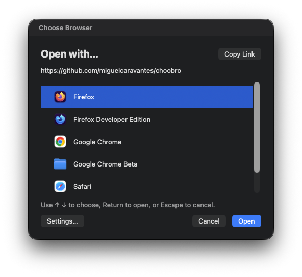

# ChooBro

**Your links. Your browser. Your choice.**

Work in Chrome. Personal browsing in Firefox. A link arrives from Teams—why should your default browser decide?

ChooBro (**Choose Browser**) lets you pick where each link opens, right when you click it.



## Why ChooBro?

- **Free. Open source. Yours.** No subscription, no account. [MIT licensed](LICENSE).
- **Native, not a website in a window.** Real macOS controls, system fonts, and light/dark appearance.
- **Lean by design.** Written in Rust with AppKit. No Electron, WebView, bundled browser engine, or background polling.
- **Quick to use.** Arrow keys to choose, Return to open. No settings detour for every link.
- **Your browsers, your rules.** Finds installed browsers automatically. Hide the ones you don't use.
- **Private by default.** No telemetry, network requests, or browsing history. Links aren't rewritten; only browser preferences are saved.

## Install

**Apple Silicon · targets macOS 12+ · early preview**

### Homebrew (recommended)

```sh
brew tap miguelcaravantes/tap
brew trust --cask miguelcaravantes/tap/choobro
brew install --cask miguelcaravantes/tap/choobro
```

Use current Homebrew; update it if `brew trust` is unavailable. The cask lives in [homebrew-tap](https://github.com/miguelcaravantes/homebrew-tap).

**Security:** ChooBro is ad-hoc signed, not Developer ID signed or Apple-notarized. The cask removes quarantine only from ChooBro.app to avoid its first-launch warning—not Gatekeeper globally. This does not make it Apple-verified. Managed Macs may block it.

### Prefer a download?

[Download the DMG](https://github.com/miguelcaravantes/choobro/releases), open it, drag ChooBro to Applications, and eject it. If macOS blocks launch, try opening it first, then use **System Settings → Privacy & Security → Open Anyway** if offered. [Apple's guidance](https://support.apple.com/en-us/102445). Never disable Gatekeeper globally.

Open ChooBro, click **Make Default Browser…** in Settings, and approve the macOS prompts. You're ready.

## Make it yours

- **Open:** choose a browser and press Return, click Open, or double-click its row.
- **Cancel:** press Escape or click Cancel.
- **Copy:** click Copy Link or press ⌘C. You get the full URL, even when the preview ends in an ellipsis; the chooser stays open.
- **Customize:** click **CB → Settings** in the menu bar to hide browsers or refresh the list. Browsers are alphabetical by default; choose **Sort → Manual**, then drag browsers or use the arrows beside the list to set the chooser order. Your manual order is saved when you switch back to alphabetical. New browsers appear at the end in manual mode.

Links arriving together open in one browser; later requests wait their turn. Pending links stay in memory, not on disk. Quitting asks before discarding them.

## Update

Quit ChooBro, then:

```sh
brew update
brew upgrade --cask miguelcaravantes/tap/choobro
```

For DMG installs, replace the app in Applications. Preferences survive updates. Quit and remove a manually installed copy before switching to Homebrew.

## Good to know

- Only HTTP/HTTPS links sent to the system default browser are handled. Embedded or app-forced browsers bypass ChooBro.
- Browser profiles, private windows, and routing rules aren't supported.
- Older macOS compatibility, startup speed, and RAM usage haven't been fully verified or benchmarked.
- Before removing ChooBro, choose another default browser in macOS Settings.

## Build from source

With Rust, Python 3, and Xcode Command Line Tools installed:

```sh
sh scripts/build-app.sh
```

Output: `dist/ChooBro.app`. On Apple Silicon, `sh scripts/build-dmg.sh` also creates a DMG and SHA-256 checksum.
