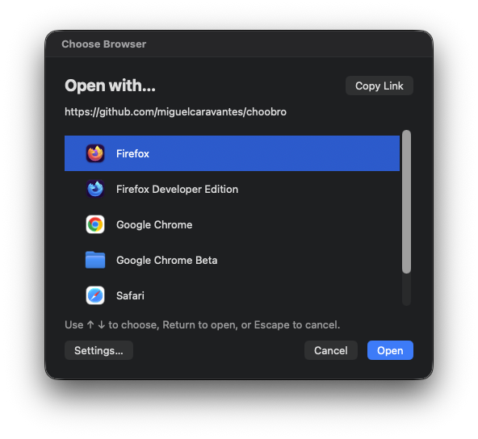

# ChooBro

**Your links. Your browser. Your choice.**

Work in Chrome. Personal browsing in Firefox. A link arrives from Teams—why should your default browser decide?

ChooBro (**Choose Browser**) lets you pick where each link opens, right when you click it.



## Why ChooBro?

- **Free. Open source. Yours.** No subscription, no account. [MIT licensed](LICENSE).
- **Native, not a website in a window.** Real macOS controls, system fonts, and light/dark appearance.
- **Lean by design.** Written in Rust with AppKit. No Electron, WebView, bundled browser engine, or background polling.
- **Quick to use.** Arrow keys to choose, Return to open. No settings detour for every link.
- **Your browsers, your rules.** Finds installed browsers automatically. Hide the ones you don't use.
- **Private by default.** No telemetry, network requests, or browsing history. Browser preferences and domain rules are saved locally.

## Install

**Apple Silicon · targets macOS 12+ · early preview**

### Homebrew (recommended)

```sh
brew tap miguelcaravantes/tap
brew trust --cask miguelcaravantes/tap/choobro
brew install --cask miguelcaravantes/tap/choobro
```

Use current Homebrew; update it if `brew trust` is unavailable. The cask lives in [homebrew-tap](https://github.com/miguelcaravantes/homebrew-tap).

**Security:** ChooBro is ad-hoc signed, not Developer ID signed or Apple-notarized. The cask removes quarantine only from ChooBro.app to avoid its first-launch warning—not Gatekeeper globally. This does not make it Apple-verified. Managed Macs may block it.

### Prefer a download?

[Download the DMG](https://github.com/miguelcaravantes/choobro/releases), open it, drag ChooBro to Applications, and eject it. If macOS blocks launch, try opening it first, then use **System Settings → Privacy & Security → Open Anyway** if offered. [Apple's guidance](https://support.apple.com/en-us/102445). Never disable Gatekeeper globally.

Open ChooBro, click **Make Default Browser…** in Settings, and approve the macOS prompts. You're ready.

## Make it yours

- **Open:** choose a browser and press Return, click Open, or double-click its row.
- **Cancel:** press Escape or click Cancel.
- **Copy:** click Copy Link or press ⌘C. You get the full URL, even when the preview ends in an ellipsis; the chooser stays open.
- **Customize:** click **CB → Settings** in the menu bar to hide browsers or refresh the list. Browsers are alphabetical by default; choose **Sort → Manual**, then drag browsers or use the arrows beside the list to set the chooser order. Your manual order is saved when you switch back to alphabetical. New browsers appear at the end in manual mode.
- **Optional Chrome profiles:** turn on **Show Chrome profiles in the chooser** in **Settings → Profiles**. Click **Open Files & Folders…**, expand **ChooBro** in System Settings, turn on **Google Chrome** or **Google Chrome Beta**, then return to ChooBro. If the switch is missing or won’t stay on, use the matching **Choose Folder…** button in the Profiles tab. Use **Settings → Browsers** to hide or reorder individual profiles. This feature is off by default. Hiding a browser also hides its profiles without resetting their settings. Auto-open still targets browsers, not profiles.
- **Domain rules:** check **Always use this choice for `<domain>`** in the chooser, or manage rules in **Settings → Rules**. Use a rule’s browser dropdown to change its browser or profile without deleting the rule. Exact domains match only that host; `*.example.com` matches `example.com` and its subdomains. Exact rules take priority over wildcard rules. ChooBro remembers a choice only after macOS accepts the handoff. If any link has a rule, ChooBro opens the batch automatically only when every link has a rule for the same uniquely available browser or profile. Otherwise, the whole batch stays in the chooser without a countdown.
- **Optional auto-open:** in Settings, enable **Automatically open a browser after waiting**, enter a positive delay in seconds (decimals work), and choose a browser. This is off by default, with an initial delay of 10 seconds; existing saved delays are preserved. The chooser shows a seconds-remaining countdown without moving its controls. Keyboard or mouse interaction in the chooser, copying a link, or opening Settings cancels automatic opening for that request; it does not restart. Each eligible queued request gets its own delay. If the saved browser is excluded, unavailable, or matches multiple installations, the link stays in the chooser. When installations share a saved browser or profile, choose manually by the paths shown in the list.

Links arriving together open in one browser; later requests wait their turn. Pending links stay in memory, not on disk. Quitting asks before discarding them.

The queue holds up to 256 links and 8 MiB of URL text. The limits apply to the original URLs, including wrappers. A request that exceeds either limit is rejected as a whole with a message; already queued links stay intact.

## Update

Quit ChooBro, then:

```sh
brew update
brew upgrade --cask miguelcaravantes/tap/choobro
```

For DMG installs, replace the app in Applications. Preferences survive updates. Quit and remove a manually installed copy before switching to Homebrew.

## Good to know

- Only HTTP/HTTPS links sent to the system default browser are handled. Embedded or app-forced browsers bypass ChooBro.
- **Microsoft Safe Links:** For recognized Teams and Outlook Safe Links, ChooBro previews and copies the decoded destination and uses its domain for browser rules. Opening still sends the original wrapper to the selected browser, preserving Microsoft’s Safe Links check. Pasting the copied destination opens it directly, outside that check.
- Experimental profile support is limited to Google Chrome and Chrome Beta profiles in their standard macOS data directories. ChooBro reads the local profile list only when the option is enabled and a supported Chrome version is available. If macOS blocks profile access, use **Profile Access Denied…** in the chooser to open the Profiles tab. It identifies the affected Chrome version and offers **Open Files & Folders…** and folder selection. The regular browser rows still work. Opening a profile passes the links as Chrome launch arguments, which other local processes may be able to see; use the regular Chrome row for sensitive links. Chrome profile launches support about 24 KiB of combined link text per request; longer requests stay in the chooser so you can select a regular browser. Private windows aren't supported.
- Older macOS compatibility, startup speed, and RAM usage haven't been fully verified or benchmarked.
- Before removing ChooBro, choose another default browser in macOS Settings.

## Build from source

With Rust, Python 3, and Xcode Command Line Tools installed:

```sh
sh scripts/build-app.sh
```

Output: `dist/ChooBro.app`. The script uses Cargo’s release executable even with a custom `CARGO_TARGET_DIR`. On Apple Silicon, `sh scripts/build-dmg.sh` also creates a DMG and SHA-256 checksum.
